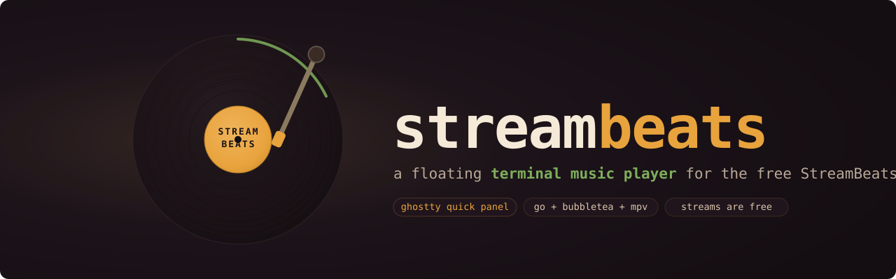

# streambeats

<div align="center">

<a href="https://github.com/egkike/streambeats-player">
  
</a>

<a href="https://github.com/Gentleman-Programming/gentle-ai">
  
</a>

</div>

A floating, quick-terminal music player for the free [StreamBeats](https://streambeats.bandcamp.com/music)
catalog — first-class Ghostty quick-panel and Kitty side presets, usable
from any Linux/macOS terminal.

The catalog streams directly from Bandcamp's mp3-128 endpoints (StreamBeats
releases are free), with an optional local library built from the same
streams. No third-party unlockers, accounts or subscriptions involved.

## Install (one line)

```sh
curl -fsSL https://raw.githubusercontent.com/egkike/streambeats-player/main/scripts/install.sh | bash
```

User-level install, no sudo: the full floating-panel experience lands in
`~/.local/bin` + `~/.local/share/streambeats`. The archive is downloaded and
SHA-256 verified against the release's `checksums.txt` before anything is
written. Details, pinned versions and the installed layout: docs/install.md.

```sh
streambeats               # TUI player, runs in any terminal
streambeats-quick right   # floating quick-terminal panel (Ghostty or kitty —
                          # the host is chosen in the TUI settings, key `c`)
```

Uninstall (the bundled CLI removes exactly what the installer landed; the
panel is stopped first and your local library — the `StreamBeats` folder
inside your XDG music dir, e.g. `~/Música` on es systems or `~/Music` on
en — is never touched):

```sh
streambeats uninstall          # add --cache to also clear the catalog cache
```

Manual inventory for installs from a pre-CLI version (v1.2.x and older):

```sh
# stop any live panel first
systemctl --user stop streambeats-panel-{top,bottom,left,right} 2>/dev/null
systemctl --user reset-failed streambeats-panel-{top,bottom,left,right} 2>/dev/null

# drop the app (all paths user-level, no sudo)
rm -rf ~/.local/share/streambeats \
       ~/.local/bin/streambeats ~/.local/bin/streambeats-quick ~/.local/bin/streambeats-panel \
       ~/.local/share/applications/streambeats-panel.desktop \
       ~/.local/share/icons/hicolor/scalable/apps/streambeats-panel.svg

# optional: the catalog cache is redownloadable — drop it too
rm -rf ~/.cache/streambeats
```

Your local library (the `StreamBeats` folder inside your XDG music dir)
and your `~/.config/streambeats/settings.json` (theme, `libraryRoot`) are
user data: nothing above ever touches them.

## Requirements

- **Linux (amd64/arm64)** — the runtime contract builds on Unix domain
  sockets (mpv IPC) and POSIX tooling; a native Windows install is refused.
- **Windows via WSL2 (Ubuntu)** — the TUI player works in WSL2 (same
  linux_amd64 runtime and sockets): install inside WSL2 with the same
  one-liner and run `streambeats` in any terminal. The floating panel is
  NOT available there — it needs Ghostty, which does not support Windows;
  the panel/flotation story stays Linux + macOS.
- **macOS (amd64/arm64, darwin)** — declared as of this release: the
  installer detects darwin, skips the Linux freedesktop integration
  (`.desktop`, hicolor icon, KWin rules are Linux-only) and points the PATH
  hint at `~/.zprofile` (zsh). The floating panel on macOS is the NATIVE
  Ghostty experience (global hotkey — better than the KDE keybind story, see
  `docs/ghostty.md`); the manual per-side presets under `assets/ghostty/`
  keep working. The installer and CLI are validated by the CI macOS job
  (real-binary install + uninstall end-to-end, bash 3.2 gate); the floating
  panel itself is CI-validated (real-binary install/uninstall); physical
  Mac live validation is accepted as out of scope — the owner has no
  macOS hardware, so CI coverage is the support contract.
- **mpv ≥ 0.41** — playback backend over JSON IPC. Without mpv the TUI still
  browses the catalog and says so in a friendly status line; it never crashes.
- **Network access to bandcamp.com** — stream URLs are tokenized and expire;
  a fresh one is resolved right before every play, never cached.
- **Ghostty 1.4.0+ or kitty 0.42+** — required only for the floating
  quick-terminal panel. Ghostty 1.4.0+ rides the native quick-terminal
  panel (with the `gdbus` helper; toggling needs no extra tools); older
  Ghostty (1.3.1+) falls back to a dedicated window (its toggle uses
  kdotool, see below); the `streambeats` TUI itself runs in any terminal
  with no version requirement. The hosting terminal is chosen in the TUI
  settings screen (`c` → Terminal; only the terminals installed on the
  machine are selectable, persisted as `panelTerminal` in
  `settings.json`) or forced per invocation with
  `streambeats-quick --terminal=<kitty|ghostty>`. The panel host change
  applies after restarting the panel. See docs/ghostty.md and
  docs/kitty.md.
- **kdotool 0.3+** (Linux, optional) — only shapes the LEGACY Ghostty path
  (a pre-1.4 dedicated-window host). It minimizes the focused panel (audio
  keeps playing) and restores/raises it on the next press. Ghostty 1.4.0+
  quick hosts — like kitty — toggle natively by re-running the launch
  command (issue #134), no kdotool involved; the installer still warns
  with the exact install paths when kdotool is missing.
- **Go 1.27+** — only for building from a source checkout (below); the user
  install never runs the compiler.

## Build

```sh
go build -o bin/streambeats ./cmd/streambeats
```

## Use

```sh
./bin/streambeats          # launch the TUI
./bin/streambeats refresh  # scrape the StreamBeats catalog into cache
./bin/streambeats sync     # download playable albums to <music dir>/StreamBeats (XDG)
./bin/streambeats help     # key bindings and paths
```

The launcher (`streambeats-quick`) auto-rebuilds `bin/streambeats` whenever
sources are newer than the binary. Direct binary runs (`kitten … ./bin/streambeats`,
`go run ./cmd/streambeats`, hand-built copies) use the LAST BUILD: run
`go build -o bin/streambeats ./cmd/streambeats` first, or last week's player
answers with last week's code.

TUI keys: `j/k` move, `enter` play/open, `l` library browser (navigate
folders; `u` goes up; the root defaults to your XDG music dir, editable
via `libraryRoot` in settings.json), `space` pause,
`s` stop, `+/-` volume, `>` next song, `<` previous song, `z` shuffles the
remaining queue (albums stay grouped; the current track keeps playing),
`c` settings,
`esc` back, `q` quit. The transport row at the bottom is visual only — the keyboard
does the work — and is terminal-adaptive (detected once at launch):
ghostty shows the emoji keycaps (⏮ ⏯ ⏹ ⏭ 🔊 🔀), any other terminal
shows
width-stable ASCII tokens (`|<` `||` `>|` `[]` `v` `sh`) so the frames stay
aligned. The player auto-advances to the next item of the list when a
track ends; the end of the queue shows `playlist ended` in the status
line. Tracks always resolve a fresh stream URL right before playing
(Bandcamp tokens expire).

`c` opens the settings screen (the nav hints advertise it as `c settings`):
three labeled sections on one flat cursor — `mode:`
(Claro / Oscuro / System), `themes:` (five artboard themes — Vinyl
dark, Synthwave night, Quiet ink, Cute, Sexy), and the installed
`panel terminal:` rows. The choice persists as a single `theme` id in
settings.json; the artboard themes are authored once for dark surfaces
(no per-theme background detection), so run them on a (near-)black
terminal background — the shipped panel presets do exactly that. Old
settings files keep working: unknown or historical ids fall back to the
default theme instead of breaking the TUI.

## Floating quick terminal

```sh
scripts/streambeats-quick [top|bottom|left|right]   # from a source checkout
streambeats-panel  [top|bottom|left|right]          # installed (detached)
```

Presets live in `assets/ghostty/streambeats-<side>.conf` (Ghostty) and
`assets/kitty/streambeats-<side>.conf` (kitty) — default side `right`,
narrow 22% strip. Toggle depends on the host: inside a Ghostty panel use
`ctrl+alt+s` (the native quick-terminal panel needs Ghostty 1.4.0+;
older builds get the dedicated-window fallback instead); the kitty quick
access terminal toggles by re-running the same launcher command (bind it
to a KDE global shortcut for one-key show/hide). Host
choice + precedence details: docs/kitty.md.

**Before installing — three honest corners** (full matrix: docs/install.md):

- **No kitty/ghostty installed?** The installer completes with an advisory;
  the `streambeats` TUI still runs in ANY terminal you already have (browse
  the catalog; playback needs mpv) — but the floating panel (ctrl+alt+m,
  menu clicks) opens nothing: the launcher fails closed with a friendly
  message until a host exists.
- **Install a terminal AFTER the app?** Nothing to reinstall — the host is
  resolved on every launch (live PATH check). Without a persisted choice
  the builtin order applies (ghostty first, then kitty); the settings
  screen (`c` → Terminal) refreshes its offered list every run. If you
  later remove a host you had persisted, the launcher says
  `requested terminal 'X' is not on PATH` — re-select in the settings menu.
- **Helpers missing (kdotool, mpv, systemd, notify-send)?** Each degrades
  one feature, never the core: kdotool only scopes the Ghostty window
  toggle (kitty toggles natively without it), mpv absence keeps the TUI
  browsing with a friendly "audio disabled" status, systemd-less sessions
  detach via setsid, notify-send falls back to stderr.

The installed companion `streambeats-panel` runs the panel detached from
any terminal so a `.desktop` entry or a KDE global keybind runs it with
one action; the desktop entry and the recommended keybind launch the
**toggle**: first press opens, later presses show/hide.
**Recommended setup (the ideal usage is fully keyboard-driven): bind a
global KDE key to it — for example `Ctrl+Alt+M` →
`$HOME/.local/bin/streambeats-panel toggle right` (this exact combo is
verified working on KDE Plasma Wayland with the default Ghostty and Plasma
keybinds; any free combo works). The 2-minute walkthrough:
docs/kde-panel-integration.md, "Keybind" section. Bind it as a **Command or
Script** (not as an Application): the Application style makes Plasma
flash a transient taskbar icon on every toggle — both styles and the
switch are documented under "Binding styles" in that doc. On Ghostty 1.4.0+
quick hosts and on kitty, the toggle is the native re-run relay (no
kdotool, no unit guard — issues #134/#108): kitty is detached by the
wrapper via `setsid`, and the ghostty quick host spawns its own claimed
app. Pre-1.4 Ghostty hosts keep the legacy path (per-side systemd user
unit + single-instance guard + kdotool toggle).
KRunner ships side actions via the generated desktop entry. Keybind + KWin
floating window-rules steps: docs/kde-panel-integration.md
(plain `scripts/streambeats-quick` stays tied to the calling shell; use the
README "Run detached" recipe for that path).

## Architecture

- `internal/catalog` — Bandcamp scraping (/music + data-tralbum), JSON
  cache, fresh stream resolution, incremental local sync.
- `internal/player` — mpv JSON IPC client (typed set_property per mpv 0.41,
  loadfile replace, event-aware).
- `internal/tui` — Bubbletea UI, pure-update model, friendly degraded mode
  without mpv.
- `scripts/install.sh` — curl-based user installer, SHA-256 verified
  (tests in `scripts/tests/install_test.sh`; detail in docs/install.md).
- `docs/ghostty.md` — Ghostty quick terminal integration details.
- `docs/kitty.md` — kitty quick access terminal panel (issue #90 choice).

## Run detached (survives the invoking terminal)

The commands above tie the player to your shell; closing the terminal
window would kill it. The installed companion is already detached:

```sh
streambeats-panel right
```

From a source checkout, launch under your user manager instead:

```sh
systemd-run --user --unit=streambeats-player \
  "${PWD}/scripts/streambeats-quick" right
```

Note (Ghostty 1.4.0+ and kitty hosts): this unit is a ONE-SHOT spawn — the
launcher returns right after opening/toggling the panel and the player
lives in its own claimed app instance, so `systemctl status` no longer
tracks the player and `systemctl stop` does not stop it: quit the player
with `q` inside the panel, or re-run `streambeats-quick`/the keybind to
hide it. On the pre-1.4 dedicated-window path the old semantics hold (the
unit stays active while the panel runs; `systemctl stop` kills it).

```sh
systemctl --user status streambeats-player   # pre-1.4 path: check
systemctl --user stop streambeats-player     # pre-1.4 path: stop player
journalctl --user -u streambeats-player      # launcher/ghostty logs
```

(Historical verification, pre-1.4 path: the unit goes active,
`WAYLAND_DISPLAY` is inherited by the user manager under KDE Plasma, and
the floating window opens with the catalog. On 1.4.0+ hosts the same
recipe shows the one-shot behavior described above.)

## Notes

- Runs as an independent floating panel beside your editor or agent
  window (Ghostty or kitty);
  nothing needs to be embedded into the agent runtime.
- MP3-128 is Bandcamp's streaming tier; for archival quality download the
  FLAC from Bandcamp manually per release.

## Contributing

This repository takes **issues only** — pull requests from outside the delivery
gate are closed automatically with a link to the policy. Bug reports and feature
requests are the whole contribution: the maintainer implements and delivers the
work under the project's internal review gate.

Read [`CONTRIBUTING.md`](./CONTRIBUTING.md) before you open anything; it is short
and it is the whole policy. Install questions are usually answered by
[`docs/install.md`](./docs/install.md) and the troubleshooting section of
[`docs/ghostty.md`](./docs/ghostty.md).
